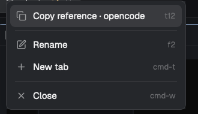

# Copy Reference

Right-click a tab or a terminal pane in Herdr and choose **Copy reference**. The clipboard receives one line that another agent can paste into its prompt; the first token is the `hc` address.

## What you see

A compact context menu with the terminal's program icon, its action, and the `hc` address on the right. The first section is one **Copy reference** row per live terminal in the tab. Rename / New tab / Close follow the usual separators. The tab bar is Herdr's tabs styled as pills, with a right-click menu that opens the same `ref-menu` for the clicked tab.

## How it behaves

- Right-click a terminal pane: the pane menu opens; **Copy reference** copies `t9 — herdr · …`.
- Right-click a tab: the tab menu opens with one copy row per terminal in that tab.
- On a TUI that captures the mouse, **Shift+right-click** opens Herdr's menu.
- The copied line includes the machine-qualified address when the terminal is remote, plus tab/space/folder context.
- `mod.open ref-menu` opens the current tab's references without a right-click.

## Built from

- `mods/ref-menu/` — clone of the shipped `menu`; adds the `ref.copy` item and clipboard handling. `ref.js` builds the line; `copy.svg` is the icon.
- `mods/tabs-ref/` — clone of the shipped `tabs`; opens `ref-menu` on right-click and sizes the popup to its rows.
- A personal layout clone (`werlang.json`) wires the `tabs` block to `tabs-ref` and the root `terminal_menu` to `ref-menu`.
- `ref.js` uses `terminals()`, `panes()`, `spaces()`, and `hc` addresses; it has no `herdr` imports so the line shape can be tested with plain Node.
- Clipboard: `osascript` on macOS, `Set-Clipboard` on Windows, `wl-copy`/`xclip` on Linux.
- `herdr-app check` validates both mods; `herdr-app shot` produced `preview.png`.

## Watch out

- **Both mods are required.** `tabs-ref` depends on `ref-menu`; installing only one loses either the tab menu or the pane menu.
- The layout must point at the personal clones. A layout reset returns the tabs block to `tabs` and the terminal menu to `menu`.
- The menu is a fixed-size popup; `tabs-ref` calculates its height from the number of copy rows.
- Do not edit the shipped `tabs`, `menu`, or `main`; Herdr restores them.
- Linux needs a clipboard tool; without `wl-copy`/`xclip` the copy action reports an error.

## Done when

- `herdr-app check` passes for `mods/ref-menu` and `mods/tabs-ref`.
- Right-clicking a terminal shows **Copy reference**, and the clipboard line starts with the right `hc` address.
- Right-clicking a tab shows one copy row per live terminal in that tab.
- `herdr-app status` reports no errors.
